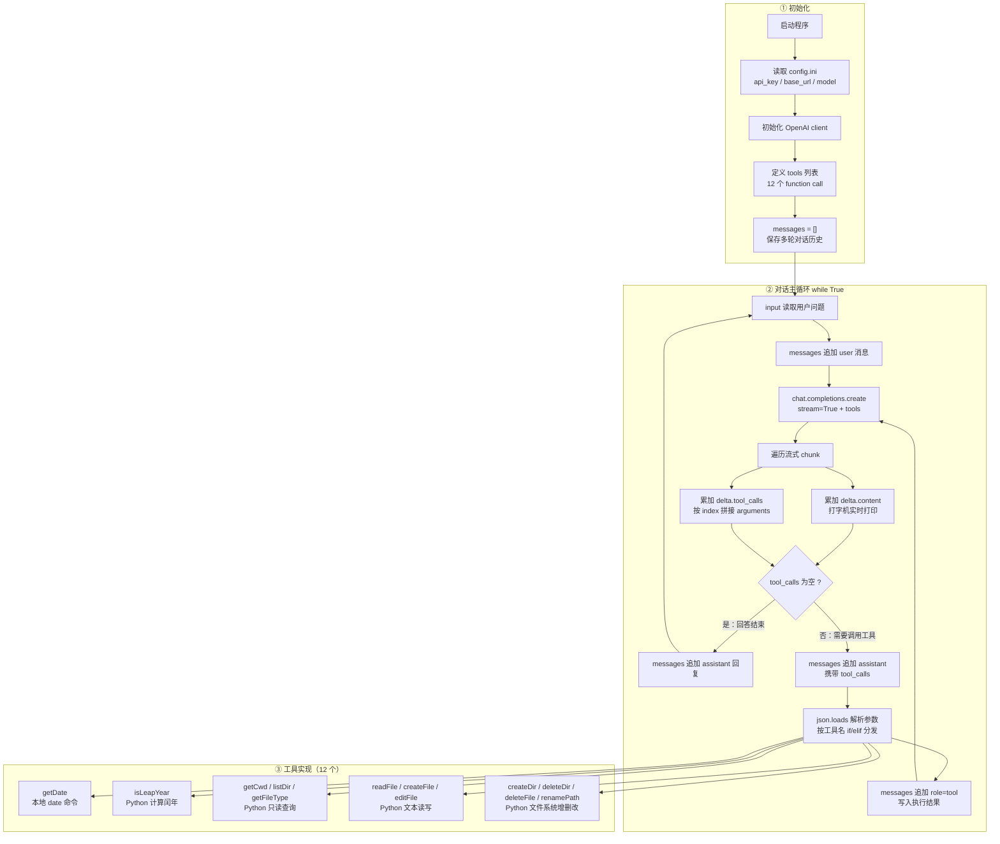

# Practice02 · LLM 命令行聊天助手（流式输出 + Function Calling）

基于 OpenAI 兼容接口的命令行对话程序，支持**打字机流式输出**、**多轮上下文**与**本地 function call 工具调用**。默认对接 DeepSeek。

## 文件说明

| 文件 | 说明 |
| --- | --- |
| `chat-stream-tool-getDate-isLeapYear-fileOps.py` | 当前主程序，包含全部 12 个工具 |
| `chat-stream-tool-getDate-isLeapYear.py` | 历史版本，仅含 getDate、isLeapYear |
| `chat-stream-tool-getDate.py` | 历史版本，仅含 getDate |
| `config.ini` | LLM 配置（已被 .gitignore 忽略） |
| `.gitignore` | Git 忽略规则 |
| `architecture.mmd` | 代码架构图（Mermaid 纯文本） |

## 环境依赖

- Python 3.8+
- openai SDK

```bash
pip install openai
```

## 配置

`config.ini`：

```ini
[llm]
api_key = 你的 API Key
base_url = https://api.deepseek.com
model = deepseek-v4-flash
```

> `api_key`、`base_url`、`model` 三项必须来自同一家服务商。

## 运行

```bash
python chat-stream-tool-getDate-isLeapYear-fileOps.py
```

输入问题后回车，模型回答以打字机效果逐字输出；回答完回到输入提示，可继续多轮对话，按 `Ctrl+C` 退出。

## 工具清单（12 个）

| # | 工具 | 功能 | 实现方式 |
| --- | --- | --- | --- |
| 1 | `getDate` | 获取当前电脑的日期和时间 | 本地 `date /t & time /t` 命令 |
| 2 | `isLeapYear` | 判断指定年份是否为闰年 | Python 计算 |
| 3 | `getCwd` | 获取当前工作目录 | `os.getcwd()` |
| 4 | `listDir` | 列出指定目录下所有文件和子目录 | `os.listdir()` |
| 5 | `getFileType` | 获取指定文件的文件类型 | `mimetypes.guess_type()`，未知时回退扩展名 |
| 6 | `readFile` | 读取纯文本文件内容 | `open()` 读取 |
| 7 | `createFile` | 按指定目录 + 文件名创建新文件 | `open(path, "w")` |
| 8 | `editFile` | 编辑纯文本文件内容 | `open(path, "w").write()` |
| 9 | `createDir` | 创建新目录 | `os.makedirs()` |
| 10 | `deleteDir` | 删除目录（支持非空目录） | `shutil.rmtree()` |
| 11 | `deleteFile` | 删除文件 | `os.remove()` |
| 12 | `renamePath` | 重命名文件或目录 | `os.rename()` |

## 工作原理

1. 程序启动时读取 `config.ini`，初始化 OpenAI client，并定义 12 个工具的 schema。
2. 每轮对话把用户消息追加进 `messages`，带上 `tools` 以 `stream=True` 调用模型。
3. 遍历流式 chunk：`delta.content` 累加并实时打印（打字机效果）；`delta.tool_calls` 按 `index` 拼装完整参数。
4. 若本轮没有工具调用，说明回答结束，把 assistant 回复追加进 `messages`，等待下一轮。
5. 若出现工具调用，则把 assistant 的 `tool_calls` 追加进 `messages`，解析参数后按工具名分发执行，把结果以 `role=tool` 追加进 `messages`，再次调用模型，直到产出最终回答。

文件操作类工具全部使用 Python 内置模块实现（`os` / `shutil` / `mimetypes`），因为路径、编码与返回值的要求更精确，比解析命令行输出更可靠；仅 `getDate` 按要求调用本地 `date` 命令。

## 架构图

见 [architecture.mmd](architecture.mmd)，可直接用支持 Mermaid 的编辑器打开，或在 GitHub 上查看下方渲染结果：



## 注意事项

- `config.ini` 内含 API Key，已加入 `.gitignore`，请勿提交到公开仓库。
- `deleteDir` / `deleteFile` 等操作会直接执行，代码中没有二次确认机制，请谨慎下发删除指令。
- 文件读写统一使用 UTF-8 编码，`readFile` / `editFile` 仅支持纯文本文件。
